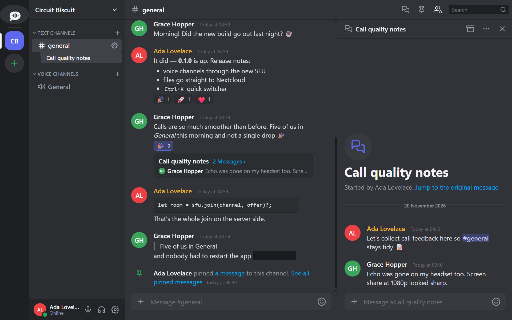
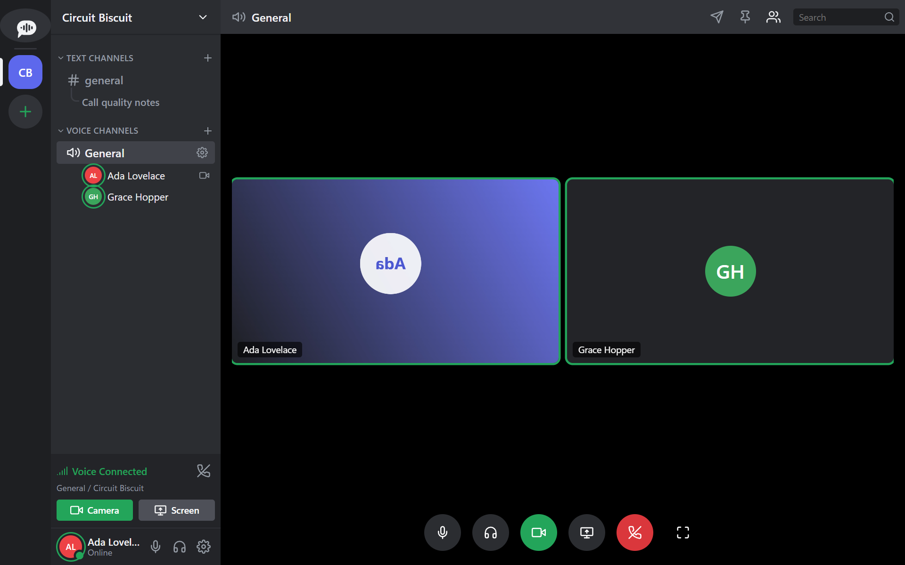

<div align="center">


# Natter

**Team chat, voice and video — fast like Discord, at home on your own Nextcloud.**

A self-hosted chat server with apps for Windows, macOS, Linux and Android — built in Rust.

[](#how-its-built)
[](#made-for-nextcloud)
[](#voice-and-video-that-scale)
[](#downloads)
[](#feature-status)



<sub><i>A space with text and voice channels: mentions, replies, reactions, Markdown and live presence.</i></sub>

[Chat](#chat-that-feels-instant) · [Calls](#voice-and-video-that-scale) · [Nextcloud](#made-for-nextcloud) · [Shortcuts](#the-little-things) · [vs. Talk](#natter-and-nextcloud-talk) · [Downloads](#downloads) · [Run a server](#run-a-server) · [Build](#quick-start) · [Changelog](CHANGELOG.md)

</div>

---

## Chat that feels instant

Messages appear the moment you press Enter, before the server has even replied, and quietly retry if the network
hiccups. A retried message can never post twice.

- **Spaces, channels, categories** — text channels, voice channels and announcement channels, grouped in collapsible categories; drag them into order right in the channel list.
- **Channel links** — "Copy Channel Link" on any channel; pasted in a message it becomes a card with **Join Voice** or **Go to Channel**.
- **Direct messages and groups** — one-to-one or up to ten people, with calls built in.
- **Threads** — spin a side conversation off any message; it opens beside the channel, shows a live card under the original message, sits under its channel in the sidebar, and archives itself after a quiet week.
- **Replies, reactions, edits, pins** — reply with or without a ping, react with any emoji, edit with ↑, pin what matters.
- **Mentions that work** — `@person`, `@everyone`, `@here` and `#channel` autocomplete as you type; mentions light up and count on every unread badge.
- **Markdown** — **bold**, *italic*, __underline__, ~~strike~~, `code`, code blocks with a copy button, quotes, headings, lists, ||spoilers||, masked links, jumbo emoji; `:)` becomes 🙂 as you send (can be turned off).
- **Unreads done right** — a red **NEW** line where you left off, "jump to present", mark as read with Esc, mark unread with Alt+click; read state syncs across your devices.
- **Search** — full-text search across a space or a conversation, results beside the chat.
- **Files** — drag and drop, paste screenshots, or pick from Nextcloud; images, video and audio play inline.
- **GIFs** — a GIF picker with categories, trending, search and favourites that follow you between devices (powered by KLIPY).
- **Presence** — online, idle (automatic), do not disturb, invisible, plus a custom status. "Ada is typing…".

## Voice and video that scale

<a href="docs/screenshot-call.png"></a>

<sub><i>A voice channel: camera tiles, speaking rings, and who's connected — also shown in the channel list.</i></sub>

Calls go through Natter's own **SFU** (selective forwarding unit) built into the server. Everyone sends their audio
and video once, and the server forwards it to everyone else. Nextcloud Talk without its separate "high-performance
backend" connects every participant to every other, which falls apart beyond four or five people.

- **Voice channels** you drop into and out of, Discord-style, and **calls in any DM** with ringing.
- **Camera, screen sharing (with sound), mute, deafen**, speaking indicators, focus any tile, full screen.
- **Stream quality you control** — Go Live presets (Text & detail, Balanced, Smooth motion) or your own resolution, frame rate and bitrate, and whether to keep it sharp or smooth when the network is tight; change any of it while live, see exactly what goes out and what holds it back, and hover a share to see what you receive. Camera resolution, frame rate and bitrate too.
- **Push to talk** — even while Natter is in the background (desktop app) — or voice activity, with echo cancellation and gain control.
- **AI noise suppression** (RNNoise, on your device): keyboard clicks, fans and background chatter don't reach the call.
- **Lost passwords:** "Forgot password?" e-mails a reset code once the server has SMTP set up (that e-mail address
  signs in too), and a server admin can always hand out a temporary password.
- **One UDP port** for all call media, encrypted in transit (DTLS-SRTP). Calls reconnect by themselves after a network change.

## Made for Nextcloud

Natter runs next to your Nextcloud and uses it for **who people are** and **where files live**. Chat, presence and
calls stay on Natter's own server, which is what keeps them fast.

- **Sign in with Nextcloud** — one click opens your Nextcloud's login page (SSO, 2FA, everything you already use), then you're in. Names and pictures come from Nextcloud.
- **Your files stay yours** — attachments are saved to your own Nextcloud (`Natter/<space>/`) and shared by read-only link. Delete the message and the share goes too; the file stays in your cloud.
- **Share from Nextcloud** — browse your Nextcloud from the message box (**+ › Share from Nextcloud**) and attach any file.
- **Any Nextcloud** — point `NATTER_NEXTCLOUD_URL` at your own Nextcloud; nothing has to be installed on the Nextcloud side.
- **Company space for everyone** — new Nextcloud users can join your main space automatically; restrict sign-in to a Nextcloud group.
- **No Nextcloud? No problem** — Natter has its own accounts and file storage too.

## The little things

| | |
|---|---|
| **Ctrl + K** | Jump to any channel, DM or person |
| **Alt + ↑ / ↓** · **Alt + Shift + ↑ / ↓** | Previous / next channel · next unread channel |
| **↑** in an empty box | Edit your last message |
| **Esc** · **Shift + Esc** | Mark channel read · mark whole space read |
| **Alt + click** | Mark unread from this message |
| **Hold Shift** on a message | Pin and delete without confirmation |
| **Shift + click** emoji | Pick several at once |
| **Ctrl + Shift + M / D** | Mute / deafen |
| **`@silent` …** | Send without notifying anyone |

On phones Natter switches to one screen at a time, like Discord's app: spaces and channels, then the chat, with
threads, members and search on top. Android's back button steps back through them; long-press a message for its menu.

Also: drafts kept per channel; an unread badge with a real number on the taskbar, tray and browser tab; a choice of
notification sounds; light, dark, darker and midnight themes plus 14 colour themes, accent colours and app icons;
compact mode, text size, zoom, reduced motion; your own global keybinds; start with the computer, close to the tray;
devices list with remote sign-out; and right-click menus everywhere.

## Daily Word

A five-letter word game built in, in **English or Turkish** (switch any time; each has its own puzzle). Everyone on
the server gets the same word each day, picked from a few thousand everyday words in an order only the server knows,
and every guess is checked there, so the answer can't be read from the app. Turkish has its own keyboard (ç ğ ı İ ö ş
ü) and treats I/ı and İ/i properly. Hard mode and high-contrast colours are one click away.

Finish and your spoiler-free grid is posted to the space's Daily Word channel (Space Settings › Overview). Next
morning at 09:00 the Daily Word bot posts yesterday's results there, tagging everyone who played and crowning the
best. Stats (streaks, guess distribution) and week, month and all-time standings sit next to the board: a win is
worth 6 points in one try down to 1 in six, and both languages count.

## Natter and Nextcloud Talk

Natter started from a full read of [Nextcloud Talk](https://github.com/nextcloud/spreed)'s features (v26) — see
[docs/FEATURES.md](docs/FEATURES.md) for the side-by-side. In short: Natter keeps Talk's essentials (conversations,
mentions, replies, reactions, edits, pins, read markers, notification levels, calls with screen sharing,
permissions, Nextcloud identity and files) and changes how they're delivered:

| | Nextcloud Talk | Natter |
|---|---|---|
| Live updates | polling, or a separate Go signaling server | built-in WebSocket gateway, push only |
| Calls | peer-to-peer mesh, or a separate Janus server | SFU built into the server, one UDP port |
| Desktop app | Electron wrapper around the web app | native Rust shell; the UI is Rust too |
| Install | PHP app inside Nextcloud | one binary + SQLite, next to Nextcloud |
| Layout | conversation list | Discord-style spaces, channels, categories, voice channels |

## Feature status

| Area | Status |
|---|---|
| Spaces, text / voice / announcement channels, categories, DMs and groups | ✅ |
| Drag-and-drop channel and category order; channel links with Join Voice / Go to Channel cards | ✅ (drag: desktop and web) |
| Messages: send, edit, delete, reply, reactions, pins, mentions, Markdown, search | ✅ |
| Threads: from any message or the channel, side panel, sidebar, auto-archive, archived list | ✅ |
| Unread markers, mention counts, read sync across devices | ✅ |
| Presence, idle, DND, invisible, custom status, typing | ✅ |
| Space profiles: your own nickname and status per space | ✅ |
| Invites (expiry, max uses), kick, ban | ✅ |
| Roles: colours, icons, 16 permissions, @everyone defaults, drag to reorder, hierarchy, one-click admin | ✅ |
| Voice & video calls via SFU, screen share, push to talk | ✅ |
| Sign in with Nextcloud, files in Nextcloud, share from Nextcloud | ✅ |
| Desktop app: tray, notifications, numbered badge, global keybinds, start with the computer | ✅ Windows · 🚧 macOS / Linux untested |
| Automatic updates: desktop installs signed releases by itself; the Android APK shows a banner linking to the new one (Google Play updates its own installs) | ✅ |
| Android app: phone layout, back button, calls, notifications while open | ✅ (APK, sideload) |
| Background push notifications on Android (app closed) | ⬜ |
| Private channels and categories, per-channel permissions (allow / inherit / deny per role or member) | ✅ |
| Link previews: YouTube plays inline, page cards, pictures and videos (SSRF-guarded, cached) | ✅ |
| GIF picker (KLIPY): categories, trending, search, synced favourites | ✅ |
| Daily Word (English / Turkish): results posts, morning summary, streaks, standings | ✅ |
| Polls, message scheduling | ⬜ |
| Simulcast (adaptive video quality for big calls), TURN / TCP fallback | ⬜ |
| iOS app | ⬜ (the web app works in mobile browsers) |
| Signed / notarised installers | ⬜ |

✅ done · 🚧 in progress · ⬜ not yet

## Downloads

> **Get the latest version:** open **[Releases › Latest](../../releases/latest)** and pick your platform.

| Platform | File | Notes |
|---|---|---|
| **Windows** | `Natter_<version>_x64-setup.exe` | One click, no admin rights. Not code-signed yet: SmartScreen › **More info › Run anyway**. |
| **macOS** (Apple Silicon + Intel) | `Natter_<version>_universal.dmg` | Drag to Applications. Not notarised yet: right-click › **Open** the first time. macOS 11+. |
| **Linux** | `Natter_<version>_amd64.AppImage` / `.deb` | `chmod +x` the AppImage and run it. |
| **Android** 7+ | `Natter_<version>.apk` | Allow "install unknown apps" for your browser once, then open the APK. |
| **Server** | `natter-server-<version>-linux-x86_64.tar.gz` | Static binary plus the web app. |

On first start the app asks for your server's address (for example `https://chat.example.com`).

After that the apps keep themselves up to date. The desktop app installs a new release when it starts, or offers
**Update** in its title bar while it's open. On Android a banner links to the new APK; the Google Play version (in testing
now) updates through Google Play.

## Run a server

```sh
NATTER_NEXTCLOUD_URL=https://cloud.example.com \
NATTER_PUBLIC_IP=203.0.113.10 \
./natter-server
```

Put HTTPS in front (Caddy or nginx), open UDP port 50000 for calls, and you're done. The first account becomes
the admin. Every setting is an environment variable — see [docs/DEPLOY.md](docs/DEPLOY.md) for a complete,
copy-pasteable setup next to an existing Nextcloud, including the systemd unit and backups.

## Quick start

Build from source with Rust 1.85 or newer plus `rustup target add wasm32-unknown-unknown` and
`cargo install trunk tauri-cli`:

```sh
git clone <this repository>
cd natter
cd crates/app && trunk build --release && cd ../..   # the UI (Rust → WebAssembly)
powershell -File scripts/dev.ps1                       # server + web app on http://localhost:8080
cd crates/desktop && cargo tauri dev                   # the desktop app against it
```

On Linux install the webview libraries first: `sudo apt install libwebkit2gtk-4.1-dev libayatana-appindicator3-dev librsvg2-dev libxdo-dev`.

Useful commands:

```sh
cargo test -p natter-proto -p natter-server -p natter-app   # protocol, Markdown, full server test (HTTP, gateway, SFU join, fake Nextcloud)
cd crates/desktop && cargo tauri build        # installers for this platform
cd crates/desktop && cargo tauri android build --apk --target aarch64 --target armv7   # Android APK (needs the Android SDK + NDK; build the UI first)
```

## How it's built

| Layer | Where | What |
|---|---|---|
| Protocol | `crates/proto` | every type the app and server exchange — one crate compiled into both, so they can't drift |
| Server | `crates/server` | axum HTTP API, WebSocket gateway, SQLite (WAL + FTS5), file store, Nextcloud bridge |
| Calls | `crates/server/src/sfu.rs` | SFU on [str0m](https://github.com/algesten/str0m): one UDP socket, rooms, renegotiation, keyframe routing |
| App | `crates/app` | the whole UI in Rust with [Leptos](https://leptos.dev), compiled to WebAssembly by trunk |
| Media glue | `crates/app/glue.js` | the main JavaScript: WebRTC, synthesized sounds, desktop bridge |
| Noise suppression | `crates/denoise`, `crates/app/denoise.js` | RNNoise ([nnnoiseless](https://github.com/jneem/nnnoiseless)) built to its own small wasm module, run on the mic in an AudioWorklet |
| Desktop & Android | `crates/desktop` | [Tauri 2](https://tauri.app) shell: tray, notifications, numbered badge, global keybinds, autostart, installers; the same crate builds the Android app (`gen/android`) |

Design notes, the full API and the gateway protocol: [docs/ARCHITECTURE.md](docs/ARCHITECTURE.md).

## Releasing a new version

Bump the version and push:

```powershell
powershell -ExecutionPolicy Bypass -File scripts\bump.ps1 0.2.0
```

(or edit `version` under `[workspace.package]` in `Cargo.toml` and push to `main`). First add a `## [0.2.0]` section to
[CHANGELOG.md](CHANGELOG.md): it becomes the release notes. The **Release** workflow notices the new version, builds
the Windows installer, the macOS universal `.dmg`, the Linux AppImage and `.deb`, and the Linux server bundle, and
publishes them as release `v0.2.0`. Pushes that don't change the version are built and tested by **CI**.

Each desktop installer is signed for the in-app updater, and the release gets a `latest.json` that lists them;
installed apps check `releases/latest/download/latest.json`. The private key is the `TAURI_SIGNING_PRIVATE_KEY`
Actions secret; the public key is `plugins.updater.pubkey` in `crates/desktop/tauri.conf.json`. If you publish your own
builds from a fork, make your own pair (`cargo tauri signer generate`) and change both, plus the GitHub address in
`plugins.updater.endpoints` and in `crates/app/src/desktop.rs`. Keep the private key safe: without it, installed apps
can't be updated any more.

The Android app is signed with a key that never goes to GitHub, so it's built locally while the workflow runs:
`scriptsndroid-release.ps1` builds the APK and the Google Play bundle, attaches the APK to the draft (so it lands in
the checksums too) and uploads the bundle to Google Play with fastlane. Setup and options:
[docs/DEPLOY.md › Releasing](docs/DEPLOY.md#releasing).

## License and credits

© Circuit Biscuit. Natter is free software under the [GNU Affero General Public License v3.0](LICENSE) or later:
use it, run it for your team, change it and share it. If you let people use a changed version over a network, offer
them its source under the same licence.

Built with Rust, axum, tokio, sqlx/SQLite, str0m, Leptos, Tauri, reqwest and argon2. Feature research from
Nextcloud Talk (AGPL-3.0; no Talk code is used). Emoji data from the `emojis` crate (Unicode / gemoji). Noise
suppression is Xiph's [RNNoise](https://github.com/xiph/rnnoise) through its Rust port nnnoiseless (both BSD-3-Clause).

Daily Word's word lists (`crates/server/words/`) are built from
[FrequencyWords](https://github.com/hermitdave/FrequencyWords) by Hermit Dave (CC BY-SA 4.0, from OpenSubtitles) and
[SCOWL](http://wordlist.aspell.net/) (the `american-english` list), then picked through by hand; those lists are
shared under CC BY-SA 4.0.
